# 🤖 Carrinho-Robô — do SMARS ao 2WD com ESP32-S3 e TinyML

**Project-based Maker Lab · FIAP** · versão 1: SMARS com Arduino Uno (Check Point 1) · versão 2:
carrinho 2WD com ESP32-S3, Wi-Fi e coleta de dados para TinyML

| Integrante | RM |
|---|---|
| Fernanda Kaory Saito | RM551104 |
| João Pedro Borsato Cruz | RM550294 |
| Maria Fernanda Vieira de Camargo | RM97956 |
| Pedro Lucas de Andrade Nunes | RM550366 |
| Sofia Amorim Coutinho | RM552534 |

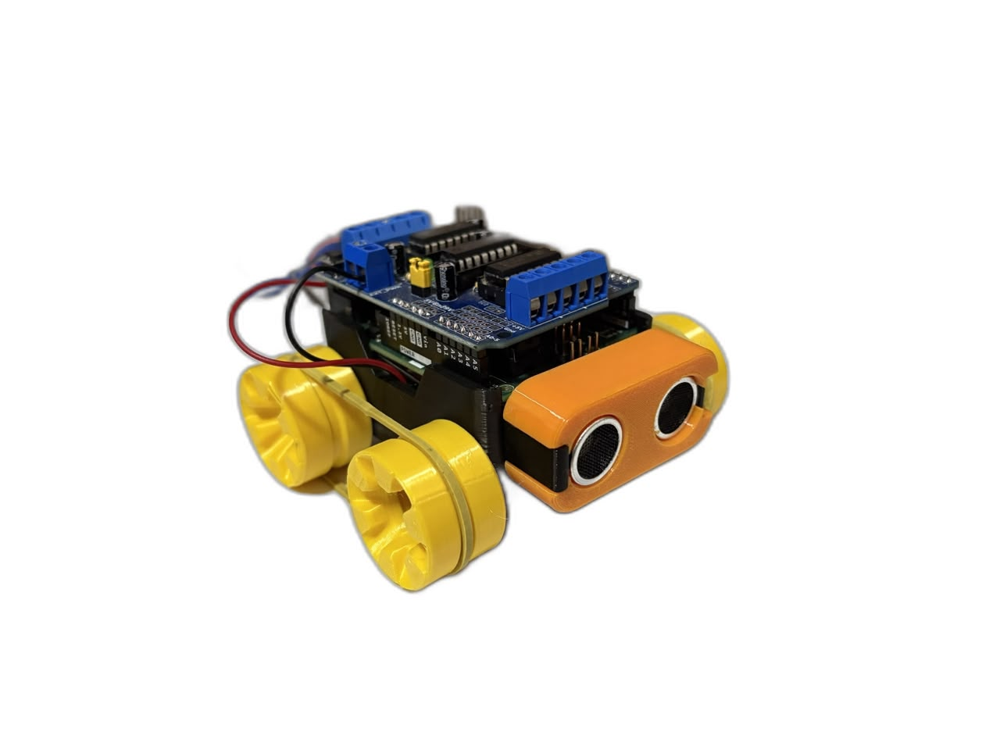

🎬 **Vídeo da versão 1 (controle remoto + sensor + modo autônomo):** https://youtu.be/DnCW8VLloSI<br>
🎬 **Vídeo da versão 2 (carrinho 2WD com ESP32-S3):** https://youtube.com/shorts/CJx2YbQ4NJw?feature=share

---

## Sumário

1. [Objetivo e descrição](#1-objetivo-e-descrição)
2. [Principais funcionalidades](#2-principais-funcionalidades)
3. [Organização do repositório](#3-organização-do-repositório)
4. [Linha do tempo do projeto](#4-linha-do-tempo-do-projeto)
5. [Requisitos, planejamento e evolução](#5-requisitos-planejamento-e-evolução)
6. [Projeto mecânico e fabricação](#6-projeto-mecânico-e-fabricação)
7. [Hardware e eletrônica](#7-hardware-e-eletrônica)
8. [Software](#8-software)
9. [Testes e resultados](#9-testes-e-resultados)
10. [Evidências finais e instruções de uso](#10-evidências-finais-e-instruções-de-uso)
11. [Custos](#11-custos)
12. [Créditos e licença](#12-créditos-e-licença)

---

## 1. Objetivo e descrição

Desenvolver um carrinho-robô funcional integrando projeto mecânico, fabricação digital, eletrônica,
programação e documentação. O robô é controlado pelo celular via **Bluetooth**, possui um **sensor
ultrassônico** que impede colisões e um **modo autônomo** em que anda sozinho desviando de obstáculos.

A estrutura é impressa em 3D a partir do projeto open-source **SMARS**, montada e adaptada pela equipe:
a proposta original com esteiras foi descartada após os testes e as **rodas foram redesenhadas** pela
equipe em quatro iterações até chegar a uma versão com canal para elástico, que resolveu a tração.

| | |
|---|---|
| **Microcontrolador** | Arduino Uno R3 |
| **Ponte H** | Shield L293D (empilhado no Uno) |
| **Motores** | 2× N20 com redução, 6 V, 500 rpm |
| **Sensor** | HC-SR04 (ultrassônico), na capa frontal |
| **Comunicação** | HC-05 (Bluetooth SPP) + app *Arduino Bluetooth RC Car* |
| **Alimentação** | Bateria 9 V no compartimento do chassi |
| **Estrutura** | Chassi SMARS impresso em PLA · rodas redesenhadas pela equipe |

### 1.1 A evolução: versão 2

A versão 1 desvia por **limiar**: abaixo de 20 cm, manobra. Ela não diferencia um obstáculo que está
chegando, quando dá para frear com antecedência, de um robô já travado, que precisa manobrar. A
versão 2 ataca isso com **TinyML**: um classificador que olha 1 s de leituras do ultrassônico e diz
se a situação é `livre`, `aproximando` ou `bloqueado`.

Isso pediu outro robô:
- **Memória:** o modelo não cabe no Uno.
- **Sem fio de verdade:** ESP32 com Wi-Fi próprio.
- **Coleta de dados séria:** roteiros automáticos, cópia de segurança na flash e um painel no
  notebook.

No caminho houve uma etapa intermediária, o **SMARS 2.0**: o mesmo chassi com um ESP32 no lugar do
Uno, onde foram feitos a primeira coleta e o primeiro treino no Edge Impulse (§8.5).

| | Versão 1 — SMARS (Check Point 1) | Versão 2 — carrinho 2WD |
|---|---|---|
| **Microcontrolador** | Arduino Uno R3 | **ESP32-S3-DevKitC-1** (WROOM-2 N32R16V: 32 MB de flash, 16 MB de PSRAM) |
| **Ponte H** | Shield L293D | **L9110S** |
| **Motores** | 2× N20, 6 V, 500 rpm | 2× **TT com redução** (os do chassi 2WD) |
| **Sensor** | HC-SR04 | HC-SR04, com o ECHO por divisor 1 kΩ / 1,5 kΩ (o ESP32 trabalha em 3,3 V) |
| **Comunicação** | HC-05 + app Bluetooth | **Wi-Fi do próprio ESP32**: página no celular e painel no notebook |
| **Alimentação** | Bateria 9 V | **4 pilhas AA** com chave; o ESP32 também nas pilhas, por diodo + capacitor |
| **Estrutura** | Chassi SMARS impresso | **Chassi 2WD de acrílico cortado a laser** |
| **Decisão de manobra** | Limiar de distância | Classificador TinyML (Edge Impulse), com o conjunto de dados do 2WD em coleta |

---

## 2. Principais funcionalidades

- **Controle remoto Bluetooth**: frente, ré, esquerda, direita, diagonais, parar e **velocidade** pelo slider do app.
- **Segurança por sensor**: no modo manual, um obstáculo a menos de 20 cm **bloqueia o avanço** (ré e giros continuam liberados); liberou o caminho, o avanço volta.
- **Modo autônomo** (botão `X` do app): anda sozinho, desacelera ao se aproximar de obstáculos e, ao encontrar um, dá ré e **gira até o sensor ver caminho livre**; se ficar preso, faz manobra de fuga.
- **Leitura robusta do ultrassônico**: timeout, mediana de 3 leituras e tratamento de "sem eco".
- **Tração diferencial** com rodas motoras 1 mm maiores que as livres (contato garantido) e elástico na banda de rodagem.
- **Telemetria** pela USB (distância, modo, comandos) para depuração e calibração.

**Na versão 2:**

- **Sem cabo:** o ESP32 cria a rede `CARRINHO-COLETA` e serve uma página de controle em
  `http://192.168.4.1`. Se a conexão cair, o carrinho para em menos de 1 s.
- **Painel no notebook:**
  - mostra a distância ao vivo, em gráfico;
  - dirige pelas setas do teclado;
  - diz o que falta gravar e confere cada rajada assim que ela chega.
- **Roteiros automáticos de coleta:** o carrinho dirige e grava sozinho, então o rótulo sai
  consistente.
  - **Aproximar:** anda reto e para a 15 cm.
  - **Livre andando:** só grava com mais de 1 m livre.
  - **Rajada 3 s:** grava o rótulo escolhido, com o carrinho como estiver.
- **Pré-processamento idêntico na coleta e na inferência:**
  - 10 Hz, faixa de 2 a 200 cm;
  - "sem eco" logo depois de uma leitura perto conta como perto;
  - mediana de 3, média móvel de 5, normalização para 0–1;
  - janelas de 1 s.
- **Coleta que não se perde:** cada rajada fica na flash com um número único, e o painel copia o que
  faltar quando o notebook volta para a rede.
- **Diagnóstico embutido:**
  - motivo do último reinício (queda de tensão, energia cortada…);
  - alerta de sensor sem eco;
  - conferência da forma de cada rajada.
- **Exportação para o Edge Impulse** com separação de treino e teste **por rajada**, para a acurácia
  medida não sair inflada.
- **Controle pelo Monitor Serial**, em qualquer uma das duas entradas USB da placa.

---

## 3. Organização do repositório

```
Robo/
├── README.md                      ← este documento
├── Abrir painel de coleta.bat     ← v2: abre o painel de coleta no navegador do notebook
├── cad/
│   ├── README.md                  ← origem dos chassis, evolução das rodas, como regenerar
│   ├── stl/robo_arduino.3mf       ← v1: projeto de fatiamento completo (9 placas, Sovol SV07)
│   ├── stl/rodas/*.stl            ← v1: rodas v1 (lisa), v2 (ranhurada) e v4 (canal p/ elástico — final)
│   └── scripts/                   ← remodel.js (gera as rodas), manifold_check.js, stl_render.js
├── hardware/
│   ├── conexoes.md                ← v1: pinagem final, diagrama e alimentação
│   ├── conexoes-2wd.md            ← v2: ESP32-S3 + L9110S + 4× AA, divisor do ECHO, o que medimos na alimentação
│   └── diagrama-componentes.*     ← diagrama da arquitetura PLANEJADA (L298N), mantido como histórico
├── software/
│   ├── smars_completo/            ← v1, FIRMWARE FINAL: Bluetooth + segurança + modo autônomo
│   ├── smars_bluetooth/           ← v1: só controle Bluetooth (didático)
│   ├── smars_desvio/              ← v1: só desvio autônomo (didático)
│   ├── historico/                 ← v1: versões iniciais mantidas como registro
│   ├── carrinho_serial/           ← v2: controle pelo Monitor Serial
│   ├── teste_hcsr04/              ← v2: teste do sensor
│   └── coleta_wifi/               ← v2: firmware da coleta (Wi-Fi, página, roteiros, rajadas na flash)
├── dados/                         ← v2
│   ├── painel.js · painel.html    ← painel de coleta (servidor local + página)
│   ├── preparar.js                ← checklist de qualidade e separação treino/teste por rajada
│   └── coleta/                    ← rajadas.jsonl (tudo o que chegou) e os CSVs gerados
├── docs/                          ← v2: plano TinyML, testes, coleta, treino e tutorial do painel
├── organizacao/                   ← MVP, MoSCoW, Backlog, Kanban (planejamento das aulas)
└── img/
    ├── carrinho-final.jpg · componentes.jpg · chassi-interno.jpg
    ├── previa.png · diagrama-blocos.png · diagrama-eletrico.png · tabela.png   (proposta inicial)
    ├── fabricacao/placa-1..9.png  ← placas de impressão
    └── rodas/                     ← renders de cada versão das rodas
```

---

## 4. Linha do tempo do projeto

| Data | Etapa | Evidência |
|---|---|---|
| **13/08** | Kickoff: repositório criado, definição dos requisitos, levantamento e medição dos componentes | commits `49098f2`, `54a73b1`; [img/tabela.png](img/tabela.png) |
| **18/08** | Proposta inicial: diagrama de blocos, diagrama elétrico (comando/potência) e prévia 3D do carrinho. Arquitetura planejada: Uno + L298N + 2× N20 + HC-SR04 + HC-05 + 7,4 V | commit `8a23aa2`; [previa](img/previa.png), [blocos](img/diagrama-blocos.png), [elétrico](img/diagrama-eletrico.png) |
| **27/08** | Planejamento: MVP, MoSCoW, backlog com 38 tarefas e kanban; projeção de custos | PR #1 `tarefa17-mvp`, commit `2977194`; [organizacao/](organizacao/) |
| **01/09** | Fabricação digital: escolha do chassi SMARS, fatiamento em 9 placas (Bambu Studio, perfil Sovol SV07); diagrama de componentes | commit `f2c2535`; [cad/stl/robo_arduino.3mf](cad/stl/robo_arduino.3mf), [img/fabricacao/](img/fabricacao/) |
| **01/09 – início de set.** | Impressão de todas as peças e montagem. **Decisões**: shield L293D no lugar da L298N; bateria 9 V no lugar de 7,4 V (compartimento do chassi) | [img/componentes.jpg](img/componentes.jpg), [img/chassi-interno.jpg](img/chassi-interno.jpg) |
| **11/09** | Primeiro teste de locomoção com **esteiras**: laço curto demais, a esteira pressionava as rodas e **travava o motor**. Tentativas: compensação XY dos furos no fatiador (0,065 → 0,115 mm), esticar cada elo 1,4 % (16 elos), lixar e lubrificar as juntas. Sem sucesso → **esteiras descartadas** | seção [Testes](#9-testes-e-resultados) |
| **15/09** | **Rodas v1 (lisas Ø32)** geradas por script a partir da roda original: dentes de engate removidos, encaixes internos preservados. **v2 ranhurada** (24 sulcos) para tração | [cad/README.md](cad/README.md), [img/rodas/](img/rodas/) |
| **16/09** | Problema: rodas motoras **girando em falso** (mesmo diâmetro das livres → perdiam contato). **v3**: motoras Ø33, livres Ø32 | `cad/stl/rodas/roda_motor_*.stl` |
| **17/09** | **v4 – canal para elástico** com parede em rampa de 45° (imprime sem suporte). Elástico nas motoras: **tração resolvida** ✅ | [img/rodas/v4-canal-render.png](img/rodas/v4-canal-render.png) |
| **17/09** | Firmware: desvio v1 → v2 (filtro, escaneio) → **v3** (gira até ver livre, fuga); Bluetooth v2 (velocidade, diagonais); **firmware unificado** com modo manual seguro + autônomo | [software/](software/) |
| **17/09** | Documentação final da versão 1 (Check Point 1) | este README |
| **set.–out.** | **SMARS 2.0**: ESP32 no lugar do Uno, primeira coleta de dados e primeiro treino no Edge Impulse. Acurácia de 77–78%, mas a classe `bloqueado` não funcionou (F1 de 0,10 a 0,14): ela foi gravada na zona cega do sensor | [§8.5](#85-tinyml-classificar-a-situação-e-não-só-a-distância) |
| **15–16/10** | **Versão 2**: chassi 2WD de acrílico cortado a laser, ESP32-S3, L9110S e 4 pilhas AA. Diagrama de fiação com a chave e o ESP32 alimentado pelas pilhas (diodo + capacitor) | [hardware/conexoes-2wd.md](hardware/conexoes-2wd.md) |
| **18/10** | Motores na L9110S, com teste de frente, ré e curvas. Erro de upload: a COM5 era uma porta de Bluetooth, não o ESP32 | [§9](#9-testes-e-resultados) |
| **24/10** | Controle por app de Bluetooth clássico não funciona: o ESP32-S3 só tem BLE. O controle passa para o Monitor Serial, com a correção da USB nativa | [software/carrinho_serial/](software/carrinho_serial/) |
| **25/10** | Esquerda e direita corrigidas no código. HC-SR04 com divisor no ECHO, testado. Plano de TinyML adaptado do SMARS 2.0 (testes, coleta, treino) e firmware `coleta_wifi` | [docs/](docs/), [software/coleta_wifi/](software/coleta_wifi/) |
| **28/10** | Primeira sessão de coleta (`livre`):<br>• reinícios por queda de tensão: as rajadas passam a ficar na flash, e a página mostra o motivo do reinício;<br>• sensor sem eco a sessão inteira: sessão descartada;<br>• **painel de coleta** no notebook | [dados/painel.js](dados/painel.js) |
| **29/10** | Coleta do `bloqueado`: o roteiro Empurrar reiniciava o carrinho com o motor travado, então o bloqueado passou a ser gravado com o carrinho parado. **60 rajadas em 4 obstáculos.** Guia do `aproximando` no painel | [dados/coleta/](dados/coleta/) |

---

## 5. Requisitos, planejamento e evolução

### 5.1 Requisitos (MVP)

Definidos em [organizacao/MVP.pdf](organizacao/MVP.pdf) e priorizados em [organizacao/MoSCoW .pdf](organizacao/MoSCoW%20.pdf):

| Requisito | Critério de aceite | Status |
|---|---|---|
| Arduino operacional | programa carregado e executando | ✅ |
| Ponte H controla os dois motores | frente, ré e curvas | ✅ (shield L293D) |
| Frente / ré / esquerda / direita / parar | movimentos executados pelo robô | ✅ |
| Bluetooth | celular envia comandos ao Arduino | ✅ |
| HC-SR04 mede distância | leitura correta em cm | ✅ (com filtro) |
| Segurança: obstáculo tem prioridade sobre o avanço | robô impede o avanço | ✅ |
| Alimentação por bateria | opera sem USB | ✅ (9 V) |
| *Should*: velocidade por PWM, distância configurável | slider do app; constantes no código | ✅ |
| *Could*: modo automático com desvio de obstáculos | robô navega sozinho | ✅ |
| *Should*: tratamento de perda do Bluetooth | estado seguro ao perder conexão | ⏳ backlog |

### 5.2 Proposta inicial e esboços

| Prévia 3D (18/08) | Diagrama de blocos planejado |
|---|---|
| 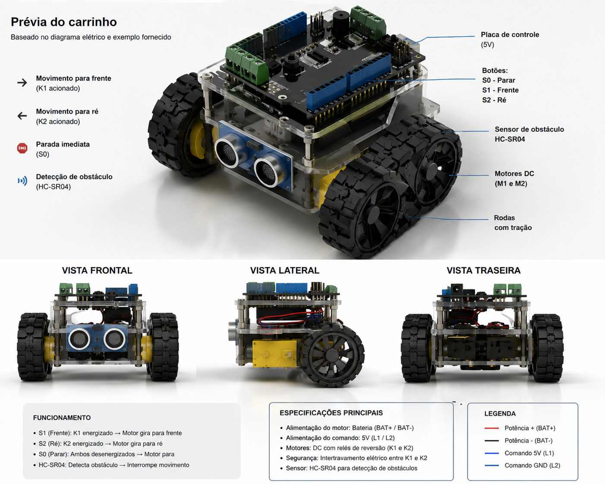 | 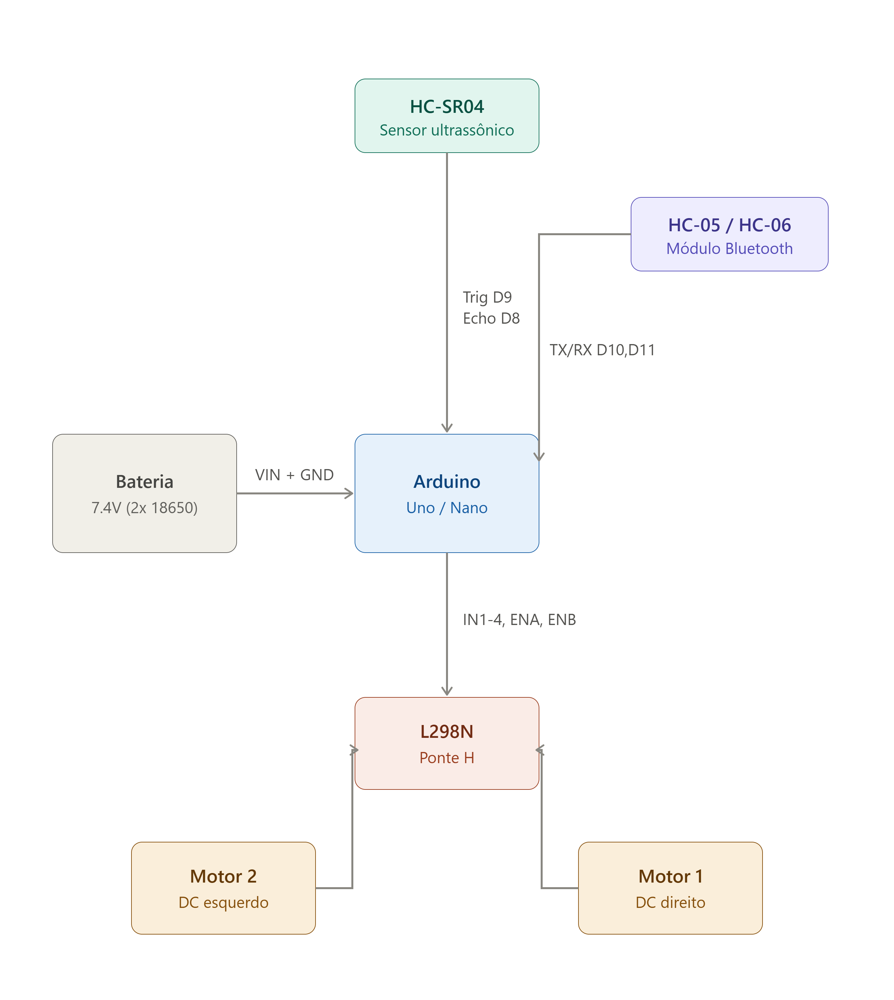 |

Diagrama elétrico da lógica de comando/potência (18/08): [img/diagrama-eletrico.png](img/diagrama-eletrico.png).
Dimensões medidas dos componentes para o projeto do chassi (13/08): [img/tabela.png](img/tabela.png).

### 5.3 Planejamento

- **MVP** — [organizacao/MVP.pdf](organizacao/MVP.pdf): quando o robô é "minimamente funcional" e quando está concluído.
- **MoSCoW** — [organizacao/MoSCoW .pdf](organizacao/MoSCoW%20.pdf): must / should / could / won't.
- **Backlog** — [organizacao/Backlog.md](organizacao/Backlog.md): 38 tarefas com responsável, dependência e critério de aceite.
- **Kanban** — [organizacao/Kanban.md](organizacao/Kanban.md): colunas, limites de WIP e sprints.

### 5.4 Decisões de projeto (planejado × construído)

| Item | Planejado (ago.) | Construído (set.) | Por quê |
|---|---|---|---|
| Ponte H | L298N avulsa, 6 fios de controle | **Shield L293D** empilhado no Uno | Encaixa direto no Uno e no chassi SMARS, elimina jumpers de controle, mais barato (R$ 11,90) |
| Alimentação | 2× 18650 (7,4 V) | **Bateria 9 V alcalina** | O chassi SMARS tem compartimento para 9 V; dispensa carregador/BMS; os 9 V compensam a queda de ~1,5 V do L293D |
| Locomoção | 2 rodas motoras + roda boba | **4 rodas: 2 motoras + 2 livres**, sem esteira | Esteira do SMARS travava o motor; rodas com elástico deram tração e permitem girar no lugar |
| Rodas | rodas do SMARS com dentes de esteira | **Rodas redesenhadas** (v4: lisas, Ø33/Ø32, canal p/ elástico) | Ver [linha do tempo](#4-linha-do-tempo-do-projeto) e [cad/README.md](cad/README.md) |
| Pinos do HC-SR04 | D8 / D9 | **A0 / A1** | D8 e D9 são usados pelo shield |
| Pinos do HC-05 | D10 / D11 | **D9 / D10** (conectores de servo do shield) | D11 é o PWM do motor M1 no shield |
| Sensor no software | só parada por obstáculo | Parada **+ desvio autônomo + fuga quando preso** | Evolução de item *could have* do MoSCoW |

### 5.5 Status final do backlog

| Tarefas | Status |
|---|---|
| T01–T10 componentes, layout, base, fixações | ✅ concluídas (chassi SMARS impresso; suportes de motor, bateria e sensor) |
| T11–T13 alimentação e ligação dos motores | ✅ (bateria 9 V → shield; motores em M1/M2) |
| T14–T20 testes dos motores e funções de movimento | ✅ |
| T21–T23 sensor conectado, leitura, parada por obstáculo | ✅ |
| T24–T26 Bluetooth e mapeamento de comandos | ✅ |
| T27 fail-safe de perda do Bluetooth | ⏳ não implementado |
| T28 calibração da distância | ✅ (constantes `DIST_PARAR`, `DIST_REDUZIR`, `DIST_LIVRE`) |
| T29–T30 movimentação integrada e detecção em movimento | ✅ |
| T31 organização dos cabos | 🔶 parcial |
| T32 autonomia da bateria | ⏳ não medida formalmente |
| T33–T34 percurso completo e correção de bugs | ✅ (ver [Testes](#9-testes-e-resultados)) |
| T35–T37 documentação de circuito, software e montagem | ✅ |
| T38 demonstração | 🎬 vídeo — link no topo |

### 5.6 Versão 2: requisitos e decisões

| Requisito da versão 2 | Status |
|---|---|
| Robô alimentado só pelas pilhas, ESP32 incluso (sem cabo) | ✅ diodo 1N5819 + capacitor 1000 µF no pino 5V |
| Controle sem fio | ✅ Wi-Fi próprio, com página e painel |
| Motores: frente, ré, curvas, giro no lugar | ✅ |
| HC-SR04 lendo em 3,3 V | ✅ divisor no ECHO |
| Coleta rotulada por **situação**, com variedade de obstáculo e velocidade | 🔄 `bloqueado` completo, `aproximando` e `livre` em andamento |
| Modelo treinado com os dados do 2WD | ⏳ depois da coleta (o primeiro modelo, do SMARS 2.0, está na §8.5) |
| Inferência no ESP32-S3 comandando os motores | ⏳ |

| Item | Versão 1 | Versão 2 | Por quê |
|---|---|---|---|
| Microcontrolador | Arduino Uno | **ESP32-S3** (32 MB flash, 16 MB PSRAM) | o modelo exportado do Edge Impulse ocupou 293 KB de flash no SMARS 2.0, e o Uno tem 32 KB; o ESP32 ainda traz Wi-Fi e 240 MHz |
| Comunicação | HC-05 (Bluetooth clássico) | **Wi-Fi** (ponto de acesso no ESP32) | o ESP32-S3 só tem BLE, e o app de HC-05 não conecta. O Wi-Fi deu, além do controle, a página de coleta e o painel no notebook |
| Ponte H | Shield L293D | **L9110S** | não existe shield no formato do ESP32; a L9110S é pequena e trabalha bem com 6 V |
| Chassi e motores | SMARS impresso, N20 | **2WD de acrílico, motores TT** | espaço para pilhas, ponte e placa; o chassi já vem com motores e rodízio |
| Alimentação | 9 V | **4× AA** com chave | uma fonte só para tudo; o diodo protege as pilhas quando o USB está ligado |
| Sensor | A0 / A1 | **GPIO 1 / GPIO 2** com divisor | o ECHO de 5 V queimaria o GPIO de 3,3 V |
| Coleta do `bloqueado` | — (no SMARS 2.0, empurrando com a mão) | **carrinho parado a 10, 20 e 30 cm** | com o motor travado, as pilhas derrubavam a tensão: o ESP32 reiniciava e o sensor errava |

---

## 6. Projeto mecânico e fabricação

### 6.1 Chassi

O chassi é o **SMARS** (Screwless Modular Assemblable Robotic System, de Kevin Thomas — projeto open-source
publicado no Thingiverse sob licença Creative Commons). Foi escolhido em 01/09 porque já prevê exatamente os
componentes do nosso planejamento: berços para motores N20, compartimento para bateria 9 V, encaixe do Arduino
Uno com shield e capa frontal para o HC-SR04. Toda a fabricação (fatiamento, impressão, pós-processamento e
montagem) foi feita pela equipe; a **adaptação mecânica** foi o redesenho completo das rodas.

**Fatiamento** — Bambu Studio 2.3, perfil Sovol SV07, bico 0,4 mm, camada 0,2 mm, PLA. Projeto completo em
[cad/stl/robo_arduino.3mf](cad/stl/robo_arduino.3mf), organizado em 9 placas:

| Placa 1 – esteiras | Placa 2 – chassi | Placa 3 – rodas originais |
|---|---|---|
| 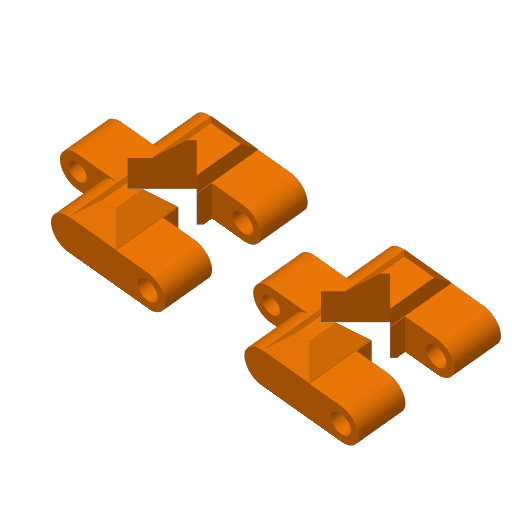 | 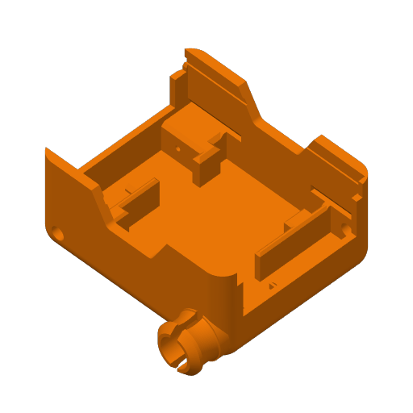 | 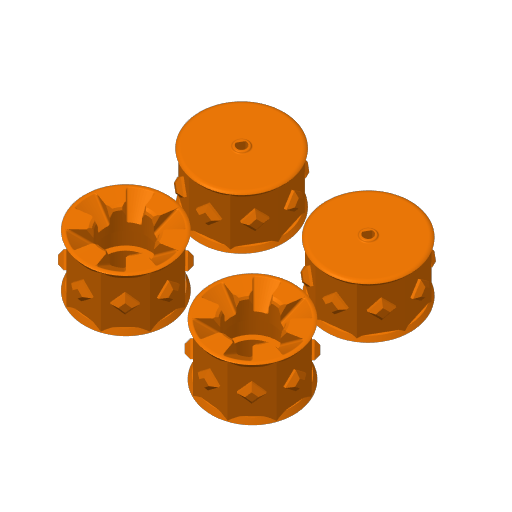 |
| **Placa 4 – suporte bateria 9 V** | **Placa 5 – suporte sensor IR (opcional)** | **Placa 6 – conector (opcional)** |
| 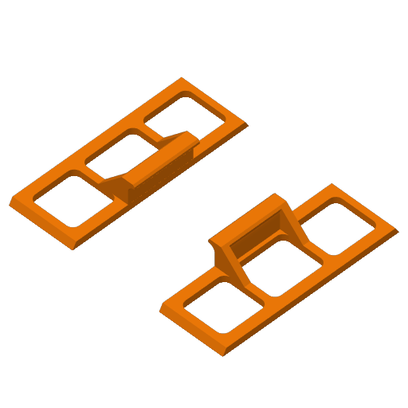 | 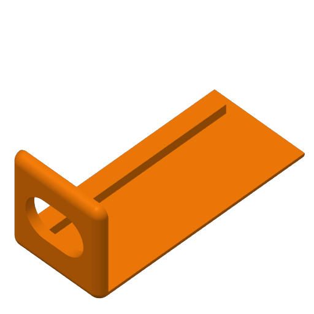 | 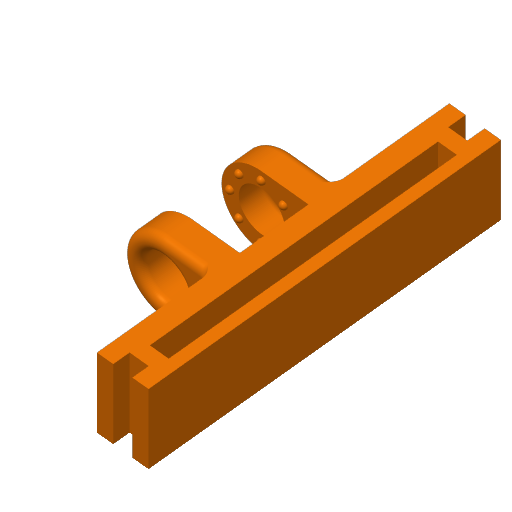 |
| **Placa 7 – capa HC-SR04 (base)** | **Placa 8 – capa HC-SR04 (a)** | **Placa 9 – capa HC-SR04 (b)** |
| 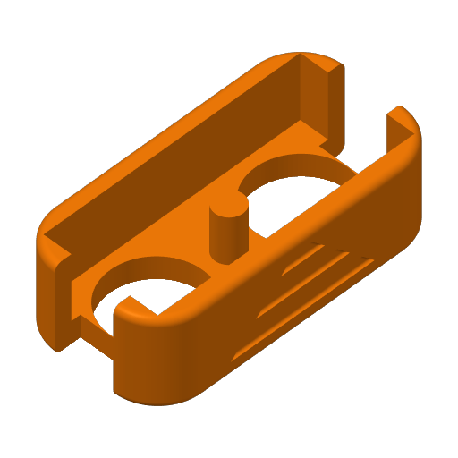 | 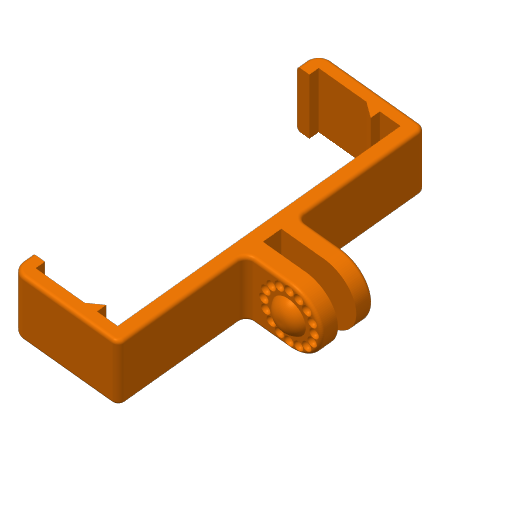 | 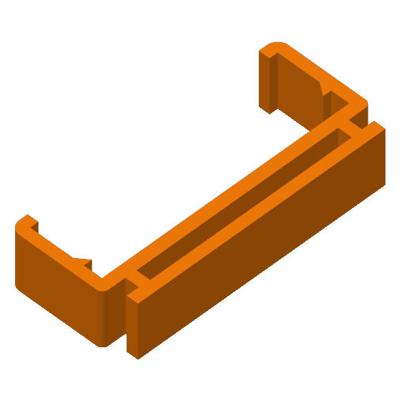 |

| Peças impressas antes da montagem | Chassi montado por baixo (motores N20 nos berços, bateria 9 V) |
|---|---|
| 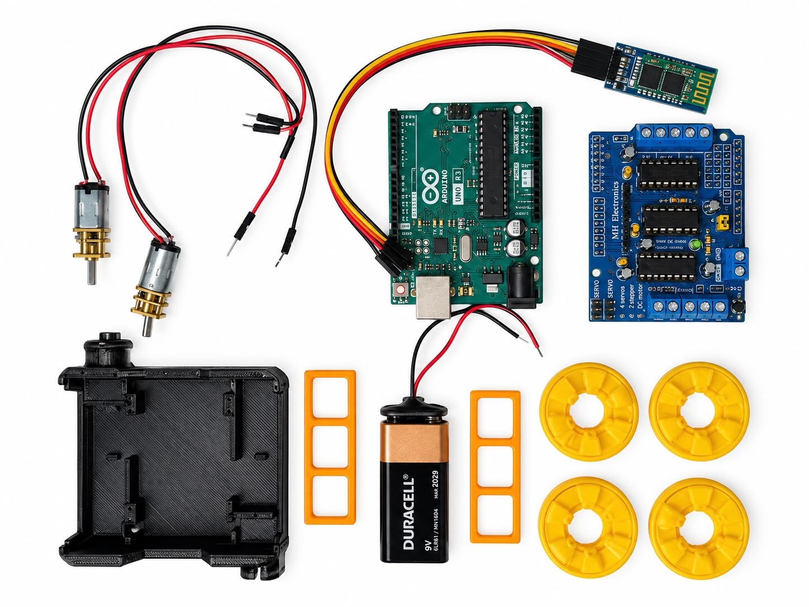 | 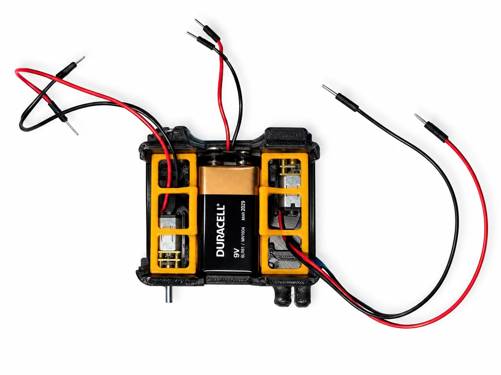 |

### 6.2 Rodas — quatro iterações

A roda original do SMARS tem 8 dentes piramidais que engatam nos losangos da esteira. Como a esteira foi
descartada, as rodas foram **regeneradas por script** ([cad/scripts/remodel.js](cad/scripts/remodel.js)) a
partir do STL original: a superfície externa é reconstruída (lisa, ranhurada ou com canal) enquanto o
**encaixe interno** (furo D do motor N20, cavidade de 6 lóbulos, furo passante da roda livre) é preservado.
Cada STL foi validado por um verificador de malha (0 arestas abertas, 0 não-manifold) antes de imprimir.

| v0 – original (dentes p/ esteira) | v1 – lisa Ø32 | v2 – ranhurada |
|---|---|---|
| 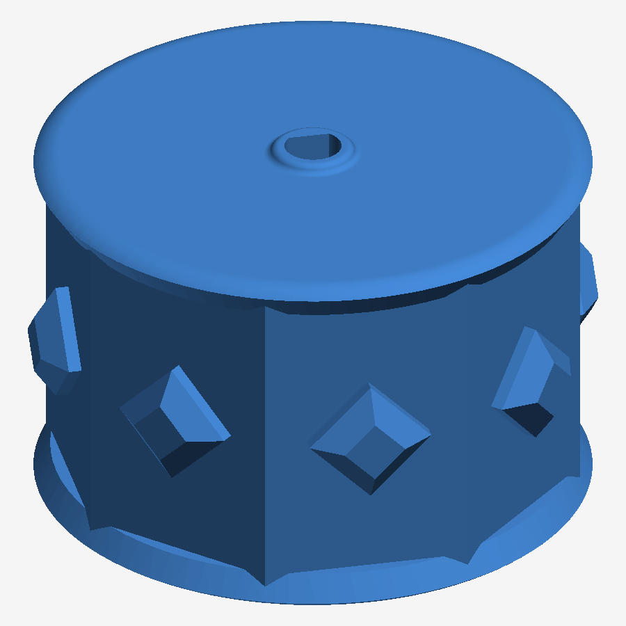 | 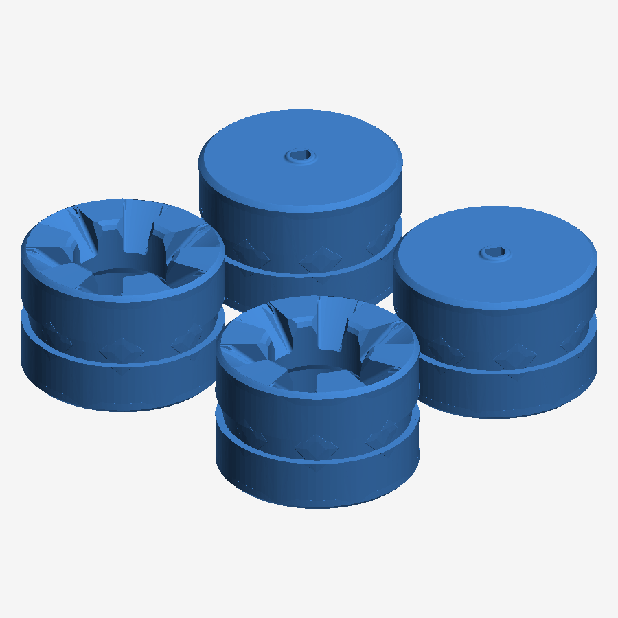 | 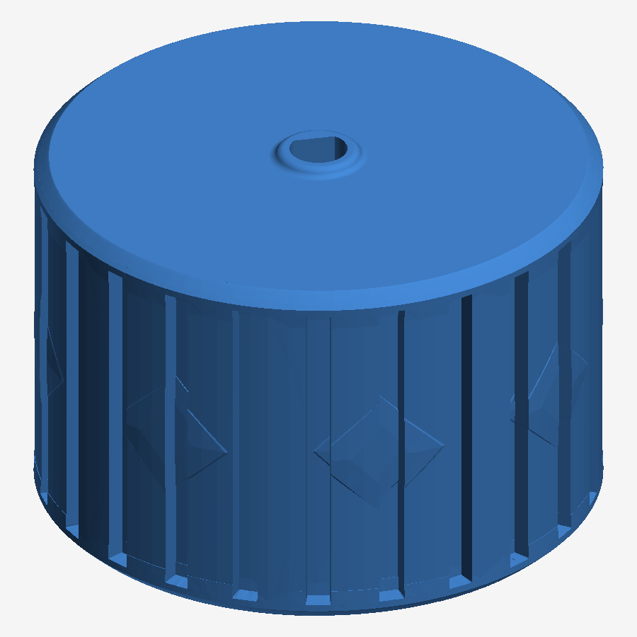 |
| **Elo da esteira descartada** | **v4 – canal para elástico (final)** | **v4 – perfil do canal** |
| 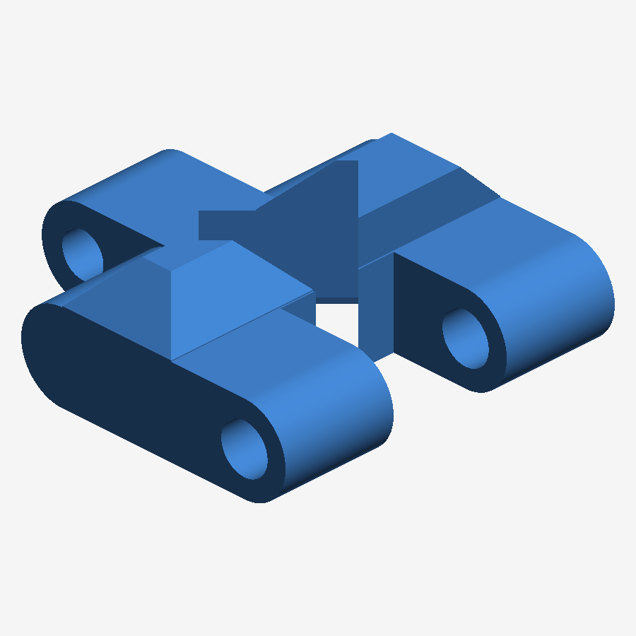 | 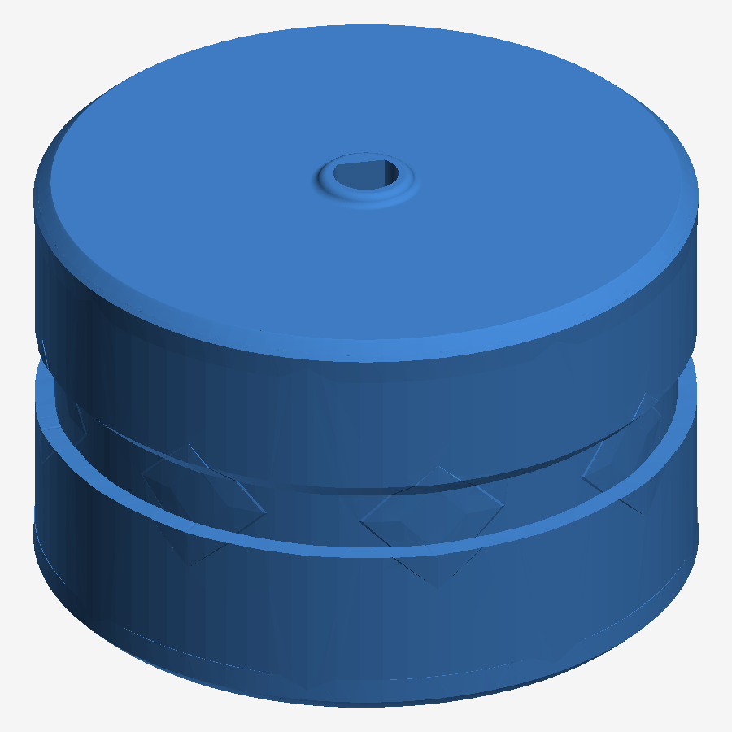 | 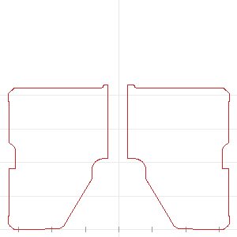 |

Decisões de detalhe da v4:
- **Motora Ø33 × livre Ø32**: com 4 rodas rígidas, diâmetros iguais deixam uma roda no ar (como mesa de 4 pés). A motora 0,5 mm mais alta garante que o carrinho sempre apoie nas rodas de tração.
- **Canal** com fundo plano de 3 mm, 1 mm de profundidade, parede inferior reta e **parede superior em rampa de 45°**: imprime deitado sem suporte.
- **Elástico só nas motoras**: as rodas livres precisam deslizar de lado para o carrinho girar no lugar.
- Chanfros de 0,8 mm nas bordas; residual dos dentes reduzido a < 0,1 mm (abaixo da resolução do bico).

Tabela completa das versões, arquivos e como regenerar: [cad/README.md](cad/README.md).

### 6.3 Carenagem e acabamento

- **Capa frontal do sensor** (peças `ultrasonic_1`, `ultrasonic_2a`, `ultrasonic_2b` — placas 7 a 9), impressa em laranja: protege e posiciona o HC-SR04 voltado para a frente, com os dois transdutores expostos.
- **Suportes internos** da bateria (laranja) e dos motores integrados ao chassi; bateria e motores ficam totalmente encapsulados, com o shield acessível por cima para programação e troca de bateria.
- **Acesso aos componentes**: a parte superior (Uno + shield) fica aberta, o que permite programar pelo USB, trocar a bateria e mexer nos bornes sem desmontar nada. Uma tampa superior encaixável está prevista como melhoria (backlog).

### 6.4 Versão 2: chassi 2WD

O chassi da versão 2 é o **2WD laser cut robot chassis** (WHoogterp,
[Thingiverse 1641782](https://www.thingiverse.com/thing:1641782)), em acrílico de 3 mm: duas rodas
motoras com motores TT, um rodízio na frente e espaço em cima para o pack de pilhas, a ponte H e o
ESP32-S3.

---

## 7. Hardware e eletrônica

### 7.1 Lista de componentes

| Componente | Qtd | Função |
|---|---|---|
| Arduino Uno R3 | 1 | Microcontrolador: lógica, leitura do sensor, comunicação |
| Shield de motores L293D (MH Electronics, compatível Adafruit v1) | 1 | Ponte H de 4 canais (usamos M1 e M2) e distribuição de energia |
| Motor N20 com redução, 6 V, 500 rpm | 2 | Tração das rodas motoras |
| Sensor ultrassônico HC-SR04 | 1 | Distância 2–400 cm, detecção de obstáculos |
| Módulo Bluetooth HC-05 | 1 | Recebe comandos do celular (SPP, 9600 bps) |
| Bateria 9 V alcalina (6LR61) | 1 | Alimenta shield, motores e Uno |
| Chassi SMARS + suportes + capa do sensor (PLA) | — | Estrutura |
| Rodas redesenhadas v4 (PLA) | 4 | 2 motoras Ø33, 2 livres Ø32 |
| Elástico de dinheiro | 2 | Banda de rodagem das motoras (2 voltas cada) |
| Jumpers macho-macho e macho-fêmea | ~10 | Sensor, Bluetooth, bateria |

### 7.2 Diagrama de conexões

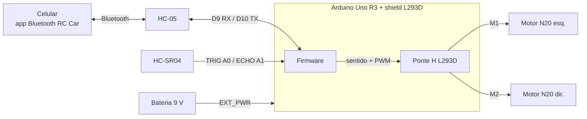

Tabela de ligações pino a pino, pinos reservados pelo shield e notas de alimentação:
**[hardware/conexoes.md](hardware/conexoes.md)**. O diagrama da arquitetura planejada (L298N) está em
[hardware/diagrama-componentes.png](hardware/diagrama-componentes.png).

### 7.3 Alimentação

Bateria 9 V no borne EXT_PWR do shield, jumper PWR instalado (o shield alimenta o Uno pelo Vin). O L293D
derruba ~1,5 V, então os motores recebem ~7,5 V. Com uma fonte menor (4 pilhas AA, 6 V) os motores ficariam
com ~4,5 V — insuficiente para vencer o atrito lateral das rodas livres nos giros no lugar.

### 7.4 Fotos da montagem

[img/componentes.jpg](img/componentes.jpg) · [img/chassi-interno.jpg](img/chassi-interno.jpg) · [img/carrinho-final.jpg](img/carrinho-final.jpg)

### 7.5 Versão 2

| Componente | Qtd | Função |
|---|---|---|
| ESP32-S3-DevKitC-1 (WROOM-2 N32R16V) | 1 | lógica, Wi-Fi, coleta e, depois, a inferência do modelo |
| Ponte H L9110S | 1 | 2 canais: motor A (direito) e motor B (esquerdo) |
| Motor TT com redução | 2 | tração |
| HC-SR04 | 1 | distância |
| Resistores 1 kΩ e 1,5 kΩ | 1 + 1 | divisor do ECHO (5 V → 3,0 V) |
| Diodo Schottky 1N5819 | 1 | pilhas → pino 5V do ESP32, bloqueia o retorno quando o USB está ligado |
| Capacitor eletrolítico 1000 µF | 1 | segura o 5V na partida dos motores |
| Suporte para 4 pilhas AA + chave liga/desliga | 1 | alimentação de tudo |
| Chassi 2WD de acrílico + rodízio | 1 | estrutura |

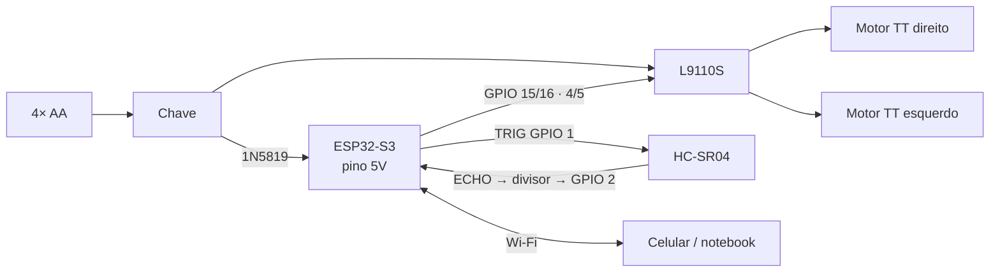

Pino a pino, o divisor e o que medimos na alimentação: **[hardware/conexoes-2wd.md](hardware/conexoes-2wd.md)**.

A alimentação foi o ponto mais difícil da versão 2. A partida dos motores derruba a tensão das
pilhas: com pilhas usadas, o ESP32 reinicia e o sensor para de devolver eco. O que resolveu:
- rampa de aceleração no firmware;
- Wi-Fi com potência reduzida;
- capacitor no 5V;
- pilhas novas a cada sessão.

O caso extremo, o motor travado contra um obstáculo, foi tirado da coleta (§9).

---

## 8. Software

### 8.1 Sketches

| Pasta | Uso | Estado |
|---|---|---|
| [`software/smars_completo/`](software/smars_completo/smars_completo.ino) | **Firmware final** — controle Bluetooth com segurança por sensor + modo autônomo, em um único upload | ✅ usar este |
| [`software/smars_bluetooth/`](software/smars_bluetooth/smars_bluetooth.ino) | Só controle Bluetooth (versão didática, sem sensor) | ✅ |
| [`software/smars_desvio/`](software/smars_desvio/smars_desvio.ino) | Só navegação autônoma (versão didática) | ✅ |
| [`software/historico/`](software/historico/) | Versões iniciais v1, com os problemas anotados no cabeçalho | histórico |

Compilação: Arduino IDE 2.x, placa **Arduino Uno**, biblioteca **Adafruit Motor Shield library (v1)**
(`AFMotor.h`). Os três sketches compilam sem avisos (≈ 6,4 kB de flash, 338 B de RAM no completo).

### 8.2 Como o programa funciona (`smars_completo`)

**Controle dos motores.** A biblioteca `AFMotor` comanda o shield: o sentido de cada canal passa por um
registrador 74HC595 e a velocidade pelos pinos PWM D11 (M1) e D3 (M2). A função `aplicar(velE, velD, dirE, dirD)`
centraliza tudo; `VEL_MAX_E/D` permitem compensar um motor mais forte para o carrinho andar reto. Curvas são
feitas por **tração diferencial**: giro no lugar (uma roda para frente, outra para trás) e diagonais com a roda
de dentro a 35 %.

**Comunicação sem fio.** O HC-05 conversa com o Uno por `SoftwareSerial` nos pinos D9/D10 a 9600 bps. O app
*Arduino Bluetooth RC Car* envia um caractere por botão:

| Caractere | Ação | | Caractere | Ação |
|---|---|---|---|---|
| `F` `B` | frente / ré | | `G` `I` | frente-esquerda / frente-direita |
| `L` `R` | gira esquerda / direita | | `H` `J` | ré-esquerda / ré-direita |
| `S` | parar (sai do autônomo) | | `0`–`9`, `q` | velocidade 10 %…100 % |
| `X` | **liga modo autônomo** | | `x` | desliga modo autônomo |

O último comando fica guardado e é reaplicado a cada volta do `loop()`, o que permite o bloqueio de segurança
descrito abaixo sem perder o comando do usuário.

**Sensor ultrassônico.** `lerCrua()` dispara o TRIG (10 µs) e mede o ECHO com `pulseIn` **com timeout de
25 ms** (sem eco = 400 cm, "livre" — a versão inicial devolvia 0 e o robô dava ré sem motivo). Um ping a
cada 60 ms e a **mediana das 3 últimas leituras** eliminam picos falsos sem travar o loop.

**Segurança (modo manual).** Se o último comando é de avanço (`F`, `G`, `I`) e a distância ≤ `DIST_PARAR`
(20 cm), os motores param; ré e giros continuam liberados. Quando o caminho libera, o avanço é retomado. Isso
implementa o requisito do MVP "obstáculo tem prioridade sobre o comando de avanço".

**Modo autônomo.** `passoAutonomo()` anda a `VEL_CRUZEIRO` e desacelera linearmente entre 45 e 20 cm. Ao
detectar obstáculo, `desviar()`: dá ré → **gira até o sensor ver ≥ 40 cm em 3 leituras seguidas** (+ margem)
→ segue. Se não abrir em 2,5 s: ré em arco para o outro lado e tenta o outro lado; se ainda não abrir:
meia-volta. Batidas seguidas mantêm o mesmo lado (a parede está do lado oposto); 3 desvios em 6 s = preso →
ré em arco longa e troca de lado. Girar "até ver livre" (em vez de girar por tempo fixo) foi a mudança que
resolveu o robô ficar oscilando frente-ré diante de paredes.

**Calibração.** Todas as constantes estão no topo do sketch: distâncias (`DIST_*`), velocidades (`VEL_*`),
tempos de manobra (`T_*`) e compensação por motor (`VEL_MAX_E/D`). O monitor serial (9600 bps) mostra o modo,
a distância e cada decisão de manobra.

### 8.3 Evolução do software

| Versão | Problema encontrado | Correção |
|---|---|---|
| v1 desvio ([historico](software/historico/v1_desvio_obstaculo.ino)) | `pulseIn` sem timeout → leituras 0 cm → ré aleatória; `int` estourava; reagia só a 7 cm; virava 500 ms às cegas | — |
| v2 desvio | filtro de mediana, reação a 20 cm, escaneio girando 45° para cada lado por tempo fixo | Ainda travava em paredes: quando o giro cronometrado ficava curto, media a mesma parede dos dois lados |
| **v3 desvio** ([smars_desvio](software/smars_desvio/smars_desvio.ino)) | — | Gira **até o sensor ver livre**, ré em arco, meia-volta, detecção de "preso", memória de lado |
| v1 Bluetooth ([historico](software/historico/v1_bluetooth.ino)) | `read()` sem `available()`; velocidade fixa; `J` tratado como parar | — |
| **v2 Bluetooth** ([smars_bluetooth](software/smars_bluetooth/smars_bluetooth.ino)) | — | slider de velocidade, diagonais, compensação por motor, 255 |
| **Unificado** ([smars_completo](software/smars_completo/smars_completo.ino)) | dois uploads diferentes para demonstrar sensor e Bluetooth | manual seguro + autônomo no mesmo firmware, alternado pelo app |

### 8.4 Versão 2: firmware e painel de coleta

| Pasta | Uso | Estado |
|---|---|---|
| [`software/carrinho_serial/`](software/carrinho_serial/carrinho_serial.ino) | controle pelo Monitor Serial: `f`, `t`, `e`, `d`, curvas, `p`, `v 150`, tempo opcional (`f 1000`) | ✅ |
| [`software/teste_hcsr04/`](software/teste_hcsr04/teste_hcsr04.ino) | o sensor sozinho, com a distância crua e uma barra no Monitor Serial | ✅ |
| [`software/coleta_wifi/`](software/coleta_wifi/coleta_wifi.ino) | **coleta para o Edge Impulse**: Wi-Fi, página, roteiros, rajadas na flash | ✅ usar este |
| [`dados/painel.js`](dados/painel.js) + [`painel.html`](dados/painel.html) | painel no notebook (atalho `Abrir painel de coleta.bat`) | ✅ |
| [`dados/preparar.js`](dados/preparar.js) | confere a qualidade e separa treino/teste **por rajada** | ✅ |

Compilação: Arduino IDE 2.x, pacote **esp32** da Espressif, placa **ESP32S3 Dev Module** (Flash OPI
80 MHz, 32 MB, PSRAM OPI). Nenhuma biblioteca externa. Detalhes em [software/README.md](software/README.md).

**Duas entradas USB.** A placa tem a USB nativa do ESP32-S3 e uma UART por chip conversor, e o
`Serial` do Arduino vai para uma ou para a outra conforme uma opção da IDE. Os sketches escrevem e
leem nas duas ao mesmo tempo, então o Monitor Serial funciona em qualquer cabo. Foi o que resolveu
"o carrinho não responde a nenhum comando".

**Como a coleta funciona** (`coleta_wifi`):

- **O que se guarda:** o ESP32 cria a rede `CARRINHO-COLETA`, serve a página e grava a **distância
  crua** de cada amostra, a 10 Hz, em **rajadas**. Cada rajada leva rótulo, obstáculo, velocidade e
  tipo. O pré-processamento só é aplicado na hora de gerar o CSV, então dá para regerar qualquer
  formato sem coletar de novo.
- **Leituras de aquecimento:** cada rajada leva junto até 7 leituras de **antes** dela, que só
  aquecem o filtro, como acontece na placa durante o uso.
- **Roteiros:** o carrinho dirige e grava sozinho, então a rajada contém **só o fenômeno**:

| Roteiro | Grava | Como |
|---|---|---|
| Aproximar | `aproximando` | anda reto, grava e para sozinho com o sensor a 15 cm |
| Livre andando | `livre` | confere se há mais de 1 m livre, anda e grava 3 s; corta o fim se algo aparecer |
| Rajada 3 s | o rótulo escolhido | grava 3 s com o carrinho como estiver: parado, girando, de ré |
| Empurrar | `bloqueado` | anda até travar num batente e grava 3 s forçando (ver §9: substituído pelo bloqueado parado) |

- **À prova de reinício:**
  - cada rajada fechada vai para a flash (LittleFS) com um **número único**, formado pelo número da
    ligação e pelo número da rajada;
  - a página mostra quantas vezes a placa reiniciou e **por quê**: queda de tensão, energia cortada,
    watchdog…;
  - a rampa de aceleração e o Wi-Fi a 5 dBm reduzem o pico de corrente.

**O painel no notebook** (`dados/painel.js`) é um servidor local em Node.js, sem dependências, com
uma página no navegador:

- **Ao vivo:** distância em gráfico (crua, filtrada e "sem eco"); setas do teclado para dirigir;
  espaço para PARAR TUDO.
- **Cópia das rajadas:** o painel copia cada rajada que o carrinho fecha, pelo número único. Se o
  notebook cai da rede ou o carrinho reinicia, ele busca na flash o que faltou quando volta. O
  Windows trocando de rede sozinho é corrigido com `netsh`.
- **Conferência imediata:** cada rajada chega com `✓ forma ok` ou `⚠` e o motivo, por exemplo "só
  30% das janelas descendo" ou "nenhum eco".
- **O que falta gravar:** a tabela *O que falta* acompanha o plano por obstáculo. O guia do
  `aproximando` diz a próxima combinação de velocidade, ângulo e partida, e o botão *Preparar*
  acerta tudo no carrinho.
- **Exportação:** *Conferir dados* roda o `preparar.js`, que gera `treino.csv` e `teste.csv` para o
  Edge Impulse.

### 8.5 TinyML: classificar a situação e não só a distância

**As classes** são rotuladas pela **situação**, e não por faixa de distância. Rótulo por faixa
reproduziria o limiar da versão 1 e daria uma acurácia alta e inútil.

| Classe | Situação |
|---|---|
| `livre` | nada perto, ou o carrinho se afastando |
| `aproximando` | distância caindo: obstáculo chegando |
| `bloqueado` | parado perto de um obstáculo (8–35 cm) |

**O pré-processamento** é idêntico na coleta e na inferência, marcado com `(*)` nos dois firmwares:

| Etapa | Valor |
|---|---|
| leitura | 10 Hz, timeout de 25 ms (~4 m) |
| faixa | 2 a 200 cm; "sem eco" logo depois de uma leitura < 20 cm repete a última (zona cega), no resto vale 200 |
| filtros | mediana de 3 (tira picos) + média móvel de 5 |
| normalização | ÷ 200 → 0 a 1 |
| janela | 10 amostras = 1 s, passo 2 no CSV |

**O primeiro modelo veio do SMARS 2.0.**
- **Os dados:** 1.543 janelas (`livre` 718 · `aproximando` 535 · `bloqueado` 290), coletadas
  empurrando o carrinho com a mão.
- **O Edge Impulse:** bloco *Raw data* + *Classification*, 20 ciclos, learning rate 0,005, os
  parâmetros fixados na aula.
- **A placa:** o modelo foi exportado como biblioteca Arduino (EON) e **rodou no ESP32** com
  `run_classifier()`, em 293 KB de flash e 24 KB de RAM.

| | Rodada 1 | Rodada 2 |
|---|---|---|
| Acurácia | 77,0% | 78,0% |
| F1 `livre` | 0,80 | 0,84 |
| F1 `aproximando` | 0,79 | 0,75 |
| **F1 `bloqueado`** | **0,14** | **0,10** |

O modelo funciona para `livre` e `aproximando` e **falha em `bloqueado`**, que virava `aproximando`
em 83% a 90% das vezes. O teste de bancada mostrou a causa física:
- **Zona cega:** o `bloqueado` foi gravado com o sensor a menos de 5 cm do obstáculo. Ali o HC-SR04
  não recebe o eco, a leitura vira 200 cm, e a janela fica igual à de um corredor vazio.
- **Tomadas longas:** as gravações contínuas de 60 a 146 s deixaram só 28% das janelas de
  `aproximando` realmente descendo.
- **Limpar o CSV não resolve:** a limpeza melhorou o número contra o próprio conjunto filtrado e
  piorou contra o conjunto original (67%). O problema estava na coleta, não no treino.

**O que a versão 2 mudou na coleta, por causa disso:**

| No SMARS 2.0 | No 2WD |
|---|---|
| tomadas de 60–146 s, com o fenômeno misturado | **rajadas curtas** gravadas pelos roteiros, só com o fenômeno |
| `bloqueado` na zona cega | `bloqueado` **a 10, 20 e 30 cm**, e rajada abaixo de 8 cm é descartada |
| `livre` com leituras médias misturadas | `livre` só com mais de 1 m à frente |
| carrinho empurrado com a mão | roteiros com o motor andando, nas velocidades do uso real |
| teste e treino cortados aleatoriamente (janelas 80% sobrepostas) | separação **por rajada**, estratificada por classe, obstáculo e velocidade |
| erro descoberto depois do treino | `preparar.js` e a conferência do painel **antes** do upload |

**Situação da coleta do 2WD (29/10):**
- **`bloqueado` completo:** 60 rajadas, 15 em cada obstáculo (parede, caixa, cadeira, canto), 660
  janelas. O checklist dá **100% das janelas paradas entre 8 e 35 cm**, a classe que reprovou no
  SMARS 2.0.
- **`aproximando` começando**, com o guia do painel.
- **`livre` a refazer:** a sessão de 28/10 foi gravada com o sensor sem eco e descartada.
- **Depois da coleta:** treinar com os mesmos parâmetros e exportar para o ESP32-S3. As metas e o
  passo a passo estão em [docs/plano-treino.md](docs/plano-treino.md):
  - acurácia ≥ 92% no *Model testing*;
  - F1 ≥ 0,90 em cada classe;
  - recall de `bloqueado` ≥ 0,90.

Os planos estão todos em [docs/](docs/):
[TinyML](docs/plano-tinyml.md) · [testes](docs/plano-testes.md) · [coleta](docs/plano-coleta.md) ·
[aproximando e bloqueado](docs/plano-aproximando-bloqueado.md) · [treino](docs/plano-treino.md) ·
[tutorial do painel](docs/tutorial-pagina-coleta.md).

---

## 9. Testes e resultados

| # | Teste | Resultado | Problema / correção |
|---|---|---|---|
| 1 | Motores individuais (frente/ré) pelo shield | ✅ | — |
| 2 | Comandos Bluetooth F/B/L/R/S pelo app | ✅ | — |
| 3 | Locomoção com **esteiras** | ❌ | Laço curto: esteira pressionava as rodas e travava o motor. Tentativas: compensação de furos no fatiador +0,05 mm, elos esticados 1,4 %, lixa e lubrificação → **esteiras descartadas** |
| 4 | Rodas v1 lisas | ❌ | Rodam, mas PLA liso patina no piso |
| 5 | Rodas v2 ranhuradas (Ø32 = Ø32) | ❌ | Motoras giravam em falso: com diâmetros iguais perdiam o contato com o chão |
| 6 | Rodas v3 (motora Ø33 > livre Ø32) | 🔶 | Contato garantido; ainda faltava atrito em piso liso |
| 7 | Rodas v4 + elástico nas motoras | ✅ | **Tração resolvida**; carrinho anda e gira no lugar |
| 8 | Força dos motores | ✅ | Software já no máximo (`setSpeed(255)`); a força é definida pela tensão no shield (9 V) — ver [hardware/conexoes.md](hardware/conexoes.md) |
| 9 | Sensor: leituras com `pulseIn` sem timeout | ❌ | Valores 0 cm → ré aleatória. Corrigido com timeout + mediana |
| 10 | Desvio v2 diante de parede | ❌ | Oscilava frente-ré (giro cronometrado insuficiente) |
| 11 | Desvio v3 / firmware unificado | 🔄 | Gira até ver caminho livre; validação final registrada no vídeo |
| 12 | Bloqueio de avanço no modo manual | 🔄 | Obstáculo a < 20 cm para o carrinho; validação no vídeo |
| 13 | Autonomia da bateria | ⏳ | Não medida formalmente |

**Resultado final da versão 1:** carrinho funcional, controlado pelo celular, com bloqueio de colisão
e modo autônomo; estrutura impressa em 3D com rodas redesenhadas pela equipe após o descarte das
esteiras.

### Versão 2

| # | Teste | Resultado | Problema / correção |
|---|---|---|---|
| 2.1 | Upload pela COM5 | ❌ | `Could not open COM5`: era uma porta criada por aparelho Bluetooth pareado. Gravar pela COM da USB nativa do ESP32 |
| 2.2 | Motores: frente, ré, curvas | ✅ | — |
| 2.3 | Controle por app de HC-05 | ❌ | O ESP32-S3 só tem **BLE**, e o app usa Bluetooth clássico (SPP). O controle passou para o Monitor Serial e depois para o Wi-Fi |
| 2.4 | Comandos pelo Monitor Serial | ❌ → ✅ | Nenhum comando chegava: o `Serial` ia para a outra entrada USB. O firmware passou a usar as duas |
| 2.5 | Esquerda e direita | ❌ → ✅ | Invertidas: corrigido no código (motor A = direita, B = esquerda), sem refazer a fiação |
| 2.6 | HC-SR04 com divisor | ✅ | Leitura parada estável (47–48 cm). O mínimo de 2 cm é o limite do sensor e do programa |
| 2.7 | Coleta: a tabela zerava | ❌ → ✅ | O ESP32 reiniciava na partida dos motores, e a RAM se perdia. Rajadas na flash, motivo do reinício na página, rampa e Wi-Fi a 5 dBm |
| 2.8 | Cópia no computador | 🔶 → ✅ | A primeira versão perdia rajadas quando o notebook caía da rede e o carrinho reiniciava junto. O painel passou a copiar pela flash, por número único |
| 2.9 | Sessão do `livre` (28/10) | ❌ | 8.166 leituras, todas **sem eco** (fio do sensor e pilhas fracas). Sessão descartada. O painel ganhou o alerta "sensor sem eco" |
| 2.10 | Roteiro Empurrar para o `bloqueado` | ❌ | 2 rajadas boas em 13 tentativas: reinícios com o motor travado e leituras abaixo de 8 cm. Na velocidade 200, o sensor ficou sem eco enquanto o motor forçava |
| 2.11 | `bloqueado` com o carrinho parado | ✅ | 60 rajadas, 4 obstáculos, ~10, ~20 e ~30 cm; 100% das janelas com a forma certa |
| 2.12 | Firmware da coleta e painel | ✅ | Compilado (990 KB, 75% da partição). Painel em uso na coleta |
| 2.13 | Modelo treinado com os dados do 2WD | ⏳ | depois de completar `aproximando` e `livre` |

---

## 10. Evidências finais e instruções de uso

- **Foto do carrinho finalizado:** [img/carrinho-final.jpg](img/carrinho-final.jpg)
- **Vídeo (controle remoto, sensor e modo autônomo):** https://youtu.be/DnCW8VLloSI
- **Vídeo da versão 2 (carrinho 2WD com ESP32-S3):** https://youtube.com/shorts/CJx2YbQ4NJw?feature=share

### Como usar

1. Coloque a bateria 9 V no compartimento e conecte-a ao borne EXT_PWR do shield. O LED do HC-05 pisca rápido (aguardando pareamento).
2. No celular, pareie com o **HC-05** (PIN `1234` ou `0000`).
3. Abra o app **Arduino Bluetooth RC Car** (Android) → ícone de engrenagem → *Connect to car* → HC-05.
4. Setas: frente, ré, esquerda, direita e diagonais. Slider: velocidade. Ao soltar o botão o carrinho para.
5. Com um obstáculo a menos de 20 cm o avanço é bloqueado automaticamente; ré e giros continuam funcionando.
6. Botão extra **X** (ligado) → **modo autônomo**; **X** (desligado), qualquer seta ou *stop* → volta ao manual.
7. Para reprogramar: retire o jumper PWR do shield (ou a bateria), conecte o USB, grave `software/smars_completo` com a IDE Arduino (placa *Arduino Uno*, biblioteca *Adafruit Motor Shield library*).

Calibração recomendada no piso da demonstração: `VEL_MAX_E/D` (andar reto) e `T_MEIA_VOLTA_MS` (tempo de 180°).

### Como usar a versão 2 (coleta)

1. Pilhas novas no suporte e chave ligada. O LED da placa pisca em verde.
2. Notebook na rede **CARRINHO-COLETA** (senha `carrinho123`).
3. Clique duas vezes em **`Abrir painel de coleta.bat`** e espere o selo verde **carrinho
   conectado**. O celular também funciona, na página `http://192.168.4.1`.
4. Ponha a mão a 20 cm do sensor: o número tem que acompanhar.
5. Clique na casa de *O que falta* que vai gravar, posicione o carrinho e aperte o roteiro.
6. A rajada aparece em *Últimas rajadas*. Se vier com `⚠`, aperte **remover** e repita.
7. No fim, aperte **Conferir dados**: com o checklist em OK, `dados/coleta/treino.csv` e
   `teste.csv` vão para o Edge Impulse.

Para gravar o firmware: solte do pino 5V o fio do diodo, conecte a USB nativa e grave
`software/coleta_wifi` (ESP32S3 Dev Module, OPI 80 MHz, 32 MB, OPI PSRAM). O passo a passo completo
está no [tutorial](docs/tutorial-pagina-coleta.md).

---

## 11. Custos

| Componente | Qtd | Unitário | Total |
|---|---|---|---|
| Motor N20 500 rpm | 2 | R$ 20,40 | R$ 40,80 |
| Arduino Uno R3 | 1 | R$ 100,07 | R$ 100,07 |
| Módulo Bluetooth HC-05 | 1 | R$ 12,90 | R$ 12,90 |
| Shield ponte H L293D | 1 | R$ 11,90 | R$ 11,90 |
| Sensor HC-SR04 | 1 | R$ 15,00 | R$ 15,00 |
| Bateria 9 V | 1 | R$ 35,00 | R$ 35,00 |
| Cabos e jumpers | — | — | R$ 5,00 |
| Filamento PLA (~150 g) | — | — | R$ 10,00 |
| Elásticos | 2 | — | R$ 0,00 |
| **Total** | | | **R$ 230,67** |

**Versão 2** (valores a preencher pela equipe):

| Componente | Qtd | Unitário | Total |
|---|---|---|---|
| ESP32-S3-DevKitC-1 (N32R16V) | 1 | | |
| Ponte H L9110S | 1 | | |
| Chassi 2WD de acrílico com 2 motores TT, rodas e rodízio | 1 | | |
| Sensor HC-SR04 | 1 | reaproveitado da v1 | — |
| Suporte para 4 pilhas AA com chave + 4 pilhas AA | 1 | | |
| Diodo 1N5819, capacitor 1000 µF, resistores 1 kΩ e 1,5 kΩ | 1 de cada | | |
| **Total** | | | |

---

## 12. Créditos e licença

- Chassi, suportes e capa do sensor: **SMARS** — Kevin Thomas, Thingiverse, licença Creative Commons (uso não comercial, atribuição).
- Chassi da versão 2: **2WD laser cut robot chassis** — WHoogterp, [Thingiverse 1641782](https://www.thingiverse.com/thing:1641782), licença Creative Commons BY-NC.
- Firmwares da versão 2, painel de coleta e planos de TinyML: equipe do projeto.
- Treino e exportação do modelo: [Edge Impulse](https://edgeimpulse.com).
- Rodas v1–v4, scripts de geração/validação, firmware e documentação: equipe do projeto.
- Biblioteca `AFMotor`: Adafruit Motor Shield library v1 (BSD).
- App de controle: *Arduino Bluetooth RC Car* (Android).
