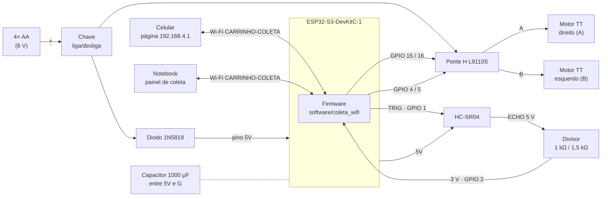

# Conexões elétricas — versão 2 (carrinho 2WD com ESP32-S3)

Arquitetura construída: ESP32-S3-DevKitC-1 (módulo WROOM-2 N32R16V) + ponte H L9110S + 2 motores TT
com redução + HC-SR04 + pack de 4 pilhas AA com chave liga/desliga. **Não há cabo:** o ESP32 é
alimentado pelas mesmas pilhas dos motores, por um diodo, e conversa com o celular e o notebook pelo
Wi-Fi que ele mesmo cria.

> A versão 1 (Arduino Uno + shield L293D + bateria 9 V) está em [conexoes.md](conexoes.md).

## Diagrama

## Tabela de ligações

| De | Para | Observação |
|---|---|---|
| Pack (+) | Chave, perna 1 | a chave tem duas pernas: uma recebe o fio do pack, a outra sai para o circuito |
| Chave, perna 2 | emenda → **L9110S VCC** e **ânodo do 1N5819** | os motores recebem a tensão cheia do pack |
| Cátodo do 1N5819 (faixa) | **ESP32 pino 5V** | o diodo impede que o USB do computador alimente as pilhas ao contrário |
| Capacitor 1000 µF | entre **5V** (+) e **G** (−) do ESP32 | segura a tensão no instante em que os motores arrancam |
| Pack (−) | GND do L9110S, **G** do ESP32, GND do sensor | **terra comum** de todo o sistema |
| L9110S A-IA / A-IB | **GPIO 15 / GPIO 16** | motor A = roda **direita** |
| L9110S B-IA / B-IB | **GPIO 4 / GPIO 5** | motor B = roda **esquerda** |
| Saídas A e B da L9110S | motores TT | se uma roda girar ao contrário, use `INVERTE_A` / `INVERTE_B` no código |
| HC-SR04 VCC | 5V do ESP32 | o sensor precisa de 5 V; abaixo de ~4,5 V ele para de devolver eco |
| HC-SR04 GND | G | |
| HC-SR04 TRIG | **GPIO 1** | os 3,3 V do ESP32 bastam para disparar |
| HC-SR04 ECHO | **R1 1 kΩ** → **GPIO 2**; **R2 1,5 kΩ** do GPIO 2 ao G | 5 V × 1,5 / 2,5 = **3,0 V**: o GPIO do ESP32-S3 não aceita 5 V |
| LED RGB da placa | GPIO 38 | estado da coleta: verde pronto, amarelo contagem, azul roteiro, vermelho gravando |

## Alimentação: o que medimos

- **4 pilhas AA novas dão ~6 V.** Depois do diodo (~0,3 V), o pino 5V do ESP32 fica com ~5,7 V, e o
  regulador da placa faz os 3,3 V.
- **A partida dos motores derruba a tensão.** Com pilhas usadas, o ESP32 reinicia, com motivo
  "queda de tensão" (brownout) ou "energia cortada", e o HC-SR04 para de medir. Foi a causa dos
  reinícios e das sessões "sem eco" da coleta. O que ajudou:
  - rampa de aceleração no firmware (10 passos de PWM a cada 10 ms);
  - potência do Wi-Fi reduzida para 5 dBm;
  - capacitor de 1000 µF no 5V;
  - pilhas novas no começo de cada sessão.
- **Motor travado** (o carrinho forçando contra um obstáculo) é o pior caso: foi por isso que a
  classe `bloqueado` passou a ser gravada com o carrinho parado.
- **Para gravar pelo USB**, solte do pino 5V o fio que vem do diodo. Se os reinícios continuarem
  durante a coleta, dá para alimentar o ESP32 por um power bank no USB, também com esse fio solto,
  e deixar as pilhas só para os motores.

## Portas e IDE

| Campo | Valor |
|---|---|
| Placa | **ESP32S3 Dev Module** |
| Flash Mode / Flash Size / PSRAM | **OPI 80 MHz** / **32 MB** / **OPI PSRAM** |
| Porta | a USB nativa (no nosso notebook, COM10, VID 303A). As COM criadas por aparelhos Bluetooth pareados não são o ESP32: o erro `Could not open COM5 ... semáforo` era isso |

Os sketches mandam as mensagens para as duas entradas da placa, USB nativa e UART, então o Monitor
Serial funciona em qualquer uma delas sem mexer na opção "USB CDC On Boot".
